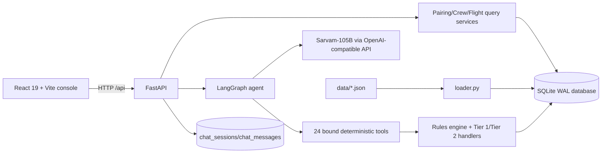
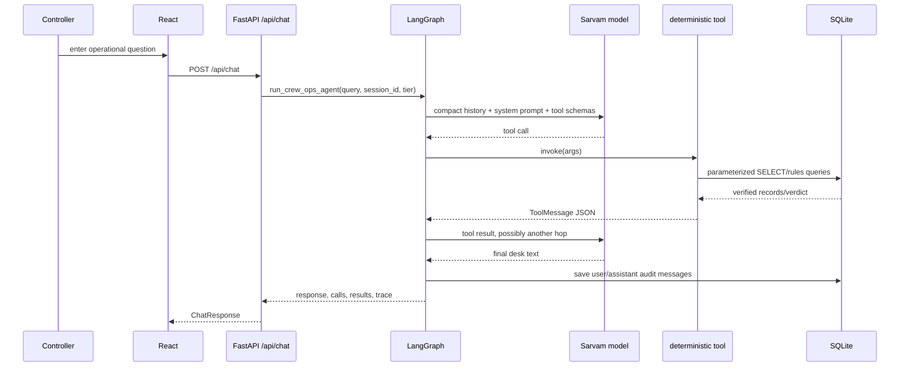

# dCortex Crew Operations Advisor — interview dossier

> Evidence convention: `[CODE]` means verified in checked-in implementation or data; `[DOC]` means stated only in documentation; `[INFERRED]` means reasoning from evidence. Every material claim has a repository citation.

## Inventory (Step 1 — show this first)

### Repository map

```text
.
├── README.md, requirements.txt, .env.example, start.sh, start.ps1
├── generate.py, validate.py, evaluate_tier1.py, evaluate_tier2.py
├── data/                         synthetic JSON snapshot and benchmark questions
├── docs/                         architecture, rules, agent, app, evaluation guides
├── src/
│   ├── api/server.py             FastAPI HTTP surface
│   ├── agent/                    LangGraph + Sarvam/OpenAI-compatible tool loop
│   ├── db/                       schema, JSON loader, chat persistence, verifier
│   ├── rules/                    deterministic legality engine and validators
│   ├── tier1/                    deterministic operational query services
│   └── tier2/                    entity joins, rule wrappers, read-only SQL
├── tests/                        pytest tests for API, agent, rules, Tier 1/2
└── frontend/
    ├── src/pages/                React routes and pages
    ├── src/components/           console UI components
    ├── src/hooks/                API/chat hooks
    └── package.json, vite.config.js
```

- `[CODE]` The backend is Python 3.10-style code using FastAPI/Pydantic, SQLite, LangGraph/LangChain, and an OpenAI-compatible `ChatOpenAI` client pointed at Sarvam. Evidence: `requirements.txt:1-12`, `src/api/server.py:11-33`, `src/agent/client.py:1-46`.
- `[CODE]` The frontend is React 19, Vite, React Router 7, Tailwind-related tooling, Radix UI primitives, TanStack utilities, and Lucide icons. Evidence: `frontend/package.json:1-40`, `frontend/src/App.jsx:1-33`.
- `[CODE]` Python entry points are `src.api.server:app`, `src.db.loader:init_db`, `validate.py`, `evaluate_tier1.py`, and `evaluate_tier2.py`; the browser entry point is `frontend/src/main.jsx`, which mounts `App`. Evidence: `src/api/server.py:29-33`, `src/db/loader.py:39-101`, `frontend/src/main.jsx:1-25`.
- `[CODE]` There is no checked-in Dockerfile, Kubernetes/Terraform/CloudFormation deployment, GitHub Actions workflow, or other CI configuration in the file inventory. `[INFERRED]` Deployment is therefore local/manual rather than reproducible infrastructure-as-code. Evidence: repository file inventory; `start.sh:1-105`, `start.ps1:1-155`.
- `[CODE]` The runtime data snapshot is synthetic and fixed around 2026-09-14 through 2026-09-20; `validate.py` reports 147 flights, 150 crew, 39 pairings, 16 reserves, 600 certifications, 6 scenarios, and 38 questions. Evidence: `data/README.md:1-20`; command result from `python3 validate.py`.

### Documents and what they add beyond code

| Document | Technical summary and information not fully contained in code |
|---|---|
| `README.md` | `[DOC]` Product framing, three-tier narrative, quickstart, claimed architecture, regulatory summary, and claimed test commands. It gives the intended system story and operational vocabulary beyond individual modules. `README.md:1-244`. |
| `docs/README.md` | `[DOC]` Documentation index and system-level diagram; it describes a Tier 2 simulator and Tier 3 optimizer that are not represented by current API routes. `docs/README.md:1-78`. |
| `docs/DATABASE_PIPELINE.md` | `[DOC]` Schema/ETL explanation, normalization rationale, WAL/index rationale, and database verification procedure. Code has schema/loader mechanics but not the prose rationale. `docs/DATABASE_PIPELINE.md:1-250`. |
| `docs/RULES_ENGINE.md` | `[DOC]` Validator architecture, seven rule catalogue, never-short-circuit principle, and testing narrative. The implementation supplies mechanics; this document supplies intended regulatory interpretation. `docs/RULES_ENGINE.md:1-190`. |
| `docs/TIER1_QUERY_ENGINE.md` | `[DOC]` Handler catalogue, benchmark question matrix, and worked rolling-duty explanation. It is useful for expected query semantics but contains stale benchmark examples relative to current data. `docs/TIER1_QUERY_ENGINE.md:1-151`. |
| `docs/PAIRINGS_WORKSPACE_AND_ENTITIES.md` | `[DOC]` Risk-band model, workspace UI contract, and Entity 360 payload intent. `docs/PAIRINGS_WORKSPACE_AND_ENTITIES.md:1-140`. |
| `docs/LANGGRAPH_AGENT.md` | `[DOC]` Agent design rationale: deterministic compaction, active-entity/coreference strategy, tool catalogue, and claimed ReAct tests. Several examples still mention nonexistent Tier 3 tools. `docs/LANGGRAPH_AGENT.md:1-150`. |
| `docs/FULLSTACK_APP.md` | `[DOC]` Frontend route architecture, endpoint catalogue, startup behavior, and claimed API test output. Its `/api/simulate` and `/api/recover` entries are doc drift against `src/api/server.py`. `docs/FULLSTACK_APP.md:1-165`. |
| `docs/BENCHMARK_AND_EVALUATION.md` | `[DOC]` Intended 92-test/38-question evaluation plan and scenario matrix. It provides evaluation intent, but the checked-in tests and current runtime do not substantiate all stated counts/features. `docs/BENCHMARK_AND_EVALUATION.md:1-117`. |
| `data/README.md` | `[DOC]` Dataset semantics, UTC/calendar-day conventions, scenario independence, engineered facts, and one explicitly acknowledged stale problem-statement correction. `data/README.md:1-65`. |
| `frontend/README.md` | `[DOC]` Frontend capability and component map. It names components/hooks that do not exactly match the current tree, so it is partly stale. `frontend/README.md:1-83`. |
| `extracted_pdf_summary.txt` | `[DOC]` Extracted problem-statement summary; it is context rather than executable specification. |
| `dcortex_solution_playbook.html` | `[DOC]` HTML solution/playbook artifact; it is not part of the Python/React runtime. |
| `problem_explanation_k66g3nx88t.pdf` | `[DOC]` Problem-statement PDF artifact; contents are not imported by runtime code. |
| Inline module docstrings/comments | `[DOC]` Design intent is embedded throughout `src/db/schema.sql`, `src/rules/engine.py`, `src/agent/graph.py`, and query modules; these are useful but can drift, as shown by Tier 3 claims. |

### Inventory gaps and doc drift found immediately

- `[CODE]` Current HTTP routes are health, stats, pairings, crew, flights, chat, and sessions; there are no `/api/simulate` or `/api/recover` routes. Evidence: `src/api/server.py:97-267`.
- `[CODE]` Current tool registry has 10 Tier 1 tools plus 14 Tier 2 tools = 24 total, not 13 total. Evidence: `src/agent/tools.py:546-577`; `tests/test_router.py:37-73` asserts the same names.
- `[DOC]` Multiple docs say “13 tools,” “three complete operational tiers,” and “active simulator/optimizer.” Evidence: `README.md:14-22`, `docs/LANGGRAPH_AGENT.md:9-18`, `docs/FULLSTACK_APP.md:20-45`.
- `[CODE]` There is no `src/tier3/` directory, no simulator/optimizer module, and no `simulate_*` or `optimize_*` function in the checked-in Python file inventory. `[INFERRED]` Tier 3 is planned/documented or removed, not currently runnable.
- `[CODE]` `evaluate_tier1.py` passes against the current data, but prints values such as Q03 = 1 DEL departure, Q10 = 21 flights, Q13 = Captain/23.5h, and Q14 includes GOI. `[DOC]` `docs/TIER1_QUERY_ENGINE.md` and `docs/BENCHMARK_AND_EVALUATION.md` state different values such as 13, 50, First Officer/78.45h, and no GOI. Evidence: command output; `docs/TIER1_QUERY_ENGINE.md:110-133`; `docs/BENCHMARK_AND_EVALUATION.md:38-58`.
- `[DOC]` `docs/FULLSTACK_APP.md:144-160` claims placeholder/simulator/recovery tests that do not appear in `tests/test_api.py:1-123`. This is a high-confidence doc/test drift.

## 1. Pitch

### 30-second version

I built a synthetic airline NOC crew-operations advisor. The core design keeps safety-sensitive legality deterministic: JSON operational data is loaded into indexed SQLite tables, Tier 1 handlers answer schedule/roster/crew-clock questions, and a Python rules engine evaluates FDP, rolling duty/flight limits, rest, ratings, certifications, base positioning, overlap, and reserve windows. A FastAPI service exposes the operational views and a LangGraph agent uses a Sarvam-105B-compatible model only to select tools and turn verified results into controller-facing prose. The React/Vite console exposes pairings, crew and flight detail, and an audited chat workflow. Evidence: `src/db/loader.py:39-101`, `src/rules/engine.py:31-358`, `src/agent/graph.py:149-206`, `src/api/server.py:97-267`, `frontend/src/App.jsx:1-33`.

### 2-minute version

The system starts from a fixed UTC synthetic snapshot. `init_db()` applies an 11-table SQLite schema, enables WAL/foreign keys, and loads flights, crew, rosters, clocks, reserves, certifications, and risk signals; rules and cost cards remain Python-loaded JSON constants. `src/db/loader.py:39-101`, `src/db/schema.sql:15-204`.

For deterministic operations, handlers query schedules, bidirectional rosters, reserve windows, certifications, risk signals, and rolling balances. Rolling calculations combine historical `duty_clock_history` through the snapshot with future planned pairing rows, then calculate headroom. `src/tier1/duty_queries.py:17-78`, `src/rules/time_utils.py:35-123`.

For a proposed assignment, `check_crew_legality()` fetches active crew metadata, derives FDP, runs all seven rule validators without short-circuiting, then adds overlap/downstream-rest/reserve checks. Base mismatch is an advisory cost flag rather than a legality failure. `src/rules/engine.py:31-222`, `src/rules/validators/base.py:7-47`.

The conversational path is a cyclic LangGraph: model → deterministic tools → model, capped at eight hops. The prompt forbids LLM arithmetic and requires a tool for operational questions; context compaction retains recent turns, replaces older tool JSON with a verified stub, and injects active entity IDs for coreference. `src/agent/graph.py:37-50`, `src/agent/graph.py:103-146`, `src/agent/graph.py:149-206`.

The honest production assessment is “well-tested prototype/MVP for a fixed synthetic snapshot,” not production-ready airline software. The dataset validator and Tier 1 standalone evaluator pass, but the full pytest suite cannot collect in this environment because declared LangChain packages are absent, there is no CI/deployment configuration, CORS is wildcard, the data is static, and the documented Tier 3 simulator/optimizer is missing. Evidence: `requirements.txt:1-12`, `src/api/server.py:35-42`, command result from `python3 -m pytest -q`, and the inventory above.

## 2. Problem & context

- `[CODE]` Problem domain: crew control needs schedule/roster lookups and deterministic regulatory feasibility checks for airline duties. Rule identifiers and inputs are explicit in `src/rules/models.py:8-22`, `src/rules/engine.py:76-118`, and `data/rules.json`.
- `[DOC]` Intended users are an airline Network Operations Control/Crew Controller desk; the UI language, prompt, and README consistently frame this as an NOC copilot. `README.md:1-22`, `src/agent/prompts.py:1-20`.
- `[CODE]` Evidenced constraints are 60 duty hours/7 calendar days, 100 flight hours/28 calendar days, 12-hour rest, type rating, certification validity, reserve window, and schedule overlap. `src/rules/config.py:15-35`, `src/rules/validators/duty.py:17-141`, `src/rules/validators/rest.py:17-144`, `src/rules/operational.py:7-118`.
- `[DOC]` Dataset convention is UTC, INR, BLR hub, and a fictional carrier over one week. `data/README.md:1-8`.
- `[CODE]` Evidenced scale is only 147 flights, 150 crew, 39 pairing IDs/42 pairing-day rows, 16 reserve people/112 reserve-day rows, and 600 certifications. `data/README.md:9-20`, `tests/test_api.py:32-42`, `src/db/schema.sql:64-159`.
- `[CODE]` No latency, cost, SLA, compliance certification, user count, production traffic, or model-quality metric is present. Do not claim any. `[INFERRED]` The repository was optimized for a deterministic hackathon/demo benchmark rather than operational deployment.
- `[INFERRED]` Likely role: primary implementer of backend/data/rules/agent and frontend integration, because the repository contains cohesive modules, tests, startup scripts, and architectural docs. Confirm exact contribution before interviewing; ownership cannot be proved from files alone.

## 3. Architecture

### Components and boundaries

- Browser: React route pages, hooks, native `fetch`, and Vite `/api` proxy. `frontend/src/App.jsx:1-33`, `frontend/src/lib/api.js:1-114`, `frontend/vite.config.js:11-21`.
- API: FastAPI route handlers and Pydantic request/response models. `src/api/server.py:29-91`, `src/api/server.py:97-267`.
- Agent: LangGraph `StateGraph`, Sarvam endpoint via `ChatOpenAI`, 24 bound tools, tool execution loop, session history. `src/agent/client.py:11-46`, `src/agent/tools.py:546-577`, `src/agent/graph.py:149-465`.
- Deterministic core: SQLite query handlers, rules engine, Tier 2 wrappers, and read-only SQL guard. `src/tier1/*.py`, `src/rules/*.py`, `src/tier2/*.py`.
- Storage: SQLite tables for operational snapshot and chat audit. Rules/costs/scenarios remain JSON/Python rather than relational data. `src/db/schema.sql:7-16`, `src/db/loader.py:327-349`.
- Sync/async: FastAPI handlers and LangGraph invocation are synchronous; the model and SQLite calls occur in request execution. `[CODE]` There is no queue, worker, background job, or async endpoint implementation. `src/api/server.py:97-267`, `src/agent/graph.py:149-465`.



### Main request sequence



### Two end-to-end flows

1. **Pairings workspace:** React calls `/api/pairings` through the Vite proxy; FastAPI validates the risk filter and calls `get_pairings_workspace`; that service joins pairing-day rows to flights, crew, risk and certification data and returns KPIs, risk bands, and rotation details; React renders cards/details. `src/api/server.py:131-154`, `src/tier1/pairings_workspace.py:1-593`, `frontend/src/hooks/usePairings.js:1-45`.
2. **Chat lookup:** `/api/chat` rejects blank input, calls `run_crew_ops_agent`, loads prior messages, compacts context, invokes the model with all tools, executes selected handlers, loops until no tool calls or eight hops, then persists the turn. `src/api/server.py:213-233`, `src/agent/graph.py:365-465`.
3. **Candidate legality:** `check_cover` resolves a pairing and either evaluates one candidate or scans same-rank candidates; `check_crew_legality` runs FDP, duty, flight, rest, qualification, certification, base, overlap, downstream-rest, and optional reserve checks; `evaluate_cover_candidates` reports legal/excluded results. `src/agent/tools.py:520-543`, `src/rules/engine.py:119-222`, `src/tier2/rules.py:560-893`.

### Critical paths to explain line by line

- `src/db/loader.py:39-101`: idempotent schema/data initialization, source-of-truth split.
- `src/rules/engine.py:119-222`: all-rule evaluation and advisory-vs-violation semantics.
- `src/rules/time_utils.py:35-123`: calendar-day window calculation and historical/planned split.
- `src/tier2/sql.py:34-95`: model-generated SQL safety gate and row cap.
- `src/agent/graph.py:103-206, 231-332, 365-465`: context compaction, model/tool loop, duplicate-call handling, persistence.
- `src/api/server.py:131-233`: HTTP validation, error mapping, and blocking agent invocation.

## 4. Tech stack & why

| Component | Choice | Why chosen | Alternatives | When alternative is better |
|---|---|---|---|---|
| Storage | SQLite WAL | Simple local relational joins, deterministic snapshot, low operational overhead. `[CODE]` `src/db/schema.sql:15-16`; `[DOC]` `docs/DATABASE_PIPELINE.md:177-217`. | Postgres | Multi-instance writes, HA, concurrent production traffic, stronger operational controls. |
| Ingestion | JSON → SQLite loader | Synthetic fixtures are easy to regenerate and inspect; `INSERT OR IGNORE` makes reloads idempotent. `[CODE]` `src/db/loader.py:39-101,121-325`. | CDC/event pipeline | Live airline feeds, incremental updates, provenance and replay. |
| API | FastAPI + Pydantic | Typed request/response validation and concise Python integration. `[CODE]` `src/api/server.py:11-13,55-91`. | Django/Flask/gRPC | Django for admin/auth-heavy products; gRPC for internal low-latency typed service-to-service calls. |
| Agent orchestration | LangGraph StateGraph | Explicit cyclic agent/tool state and bounded hops. `[CODE]` `src/agent/graph.py:37-37,336-362`. | Plain function router / workflow engine | Better for fixed intent routing or durable long-running workflows. |
| Model client | `ChatOpenAI` pointed at Sarvam-105B | Reuses OpenAI-compatible tool-calling abstraction while selecting Sarvam. `[CODE]` `src/agent/client.py:11-46`. | Hosted OpenAI/Anthropic, self-hosted model | Better if tool-call reliability, latency, privacy, or regional availability is superior. |
| Rule computation | Python validators/config JSON | Regulatory calculations need deterministic, explainable output and testability. `[CODE]` `src/rules/config.py:15-35`, `src/rules/validators/*.py`. | Rules DSL/OPA | Better for centrally governed policies across many services/languages. |
| UI | React + Vite + Tailwind | Fast interactive operations console and local proxy. `[CODE]` `frontend/package.json:1-40`, `frontend/vite.config.js:11-21`. | Server-rendered app | Better for SEO/simple forms or reducing browser bundle/runtime complexity. |
| Chat audit | SQLite JSON columns | Preserves user/assistant text, tool calls/results, and traces in one local store. `[CODE]` `src/db/schema.sql:188-204`, `src/db/chat_store.py:214-317`. | Event log/object storage | Better for immutable, queryable, high-volume audit retention and redaction policies. |

## 5. Key decisions & trade-offs

| Decision | Context | Options considered | Why this one | Cost/trade-off | What changes it |
|---|---|---|---|---|---|
| 1. SQLite snapshot | Small synthetic operational dataset. | SQLite, Postgres, warehouse. | Minimal setup and relational joins. `src/db/schema.sql:23-204`. | Single-file durability/locking and no HA. | Multi-instance writes, live feeds, or availability SLA. |
| 2. Normalize core entities, keep some JSON | Flights/crew/pairings need joins; ratings and flight lists are nested in source data. | Fully normalized, document DB, JSON-only. | Tables/indexes support deterministic lookups while loader preserves source shape. `src/db/schema.sql:23-170`, `src/db/loader.py:159-204`. | `ratings` and `flights_json` weaken relational constraints/queryability. | Frequent nested filtering or data-integrity incidents. |
| 3. Rules configurable from `rules.json` | Thresholds should not be hardcoded. | Constants, database policy service, JSON config. | Import-time config centralizes seven rule parameters. `src/rules/config.py:15-35`. | Import-time failure if file missing; no versioned effective dates/approvals. | Regulation versioning, audit requirements, or live policy changes. |
| 4. Never short-circuit legality | Operators need all reasons, not only first failure. | Fail-fast, aggregate all, LLM judge. | Aggregate `RuleResult`s and distinguish violation/advisory. `src/rules/engine.py:163-222`. | More work per request; callers must understand advisory semantics. | Latency pressure or rule dependency ordering. |
| 5. LLM selects tools, never performs safety math | Hallucinated arithmetic is unacceptable. | LLM-only, deterministic engine only, hybrid. | Hybrid gives natural language UX with deterministic verdicts. `src/agent/prompts.py:1-20`, `src/agent/graph.py:149-206`. | Model can still choose wrong tool/arguments or phrase results incorrectly. | Need strict intent router, offline model, or certified decision service. |
| 6. Synchronous ReAct loop with hop cap | Questions may need entity-to-duty multi-hop reasoning. | One-shot, async workflow, durable queue. | Simple request lifecycle, max eight hops prevents infinite loop. `src/agent/graph.py:37-37,336-362`. | Model latency blocks request; no durable retry/checkpoint; eight hops is arbitrary. | P95 latency/SLA or long-running disruption planning. |
| 7. Calendar-day rolling windows | Dataset/rules define UTC calendar semantics. | Sliding 24-hour windows, local-time windows. | Matches synthetic rule contract and regulator interpretation encoded in data. `src/rules/time_utils.py:35-123`, `data/README.md:28-38`. | Fixed UTC snapshot/data range makes real-time rollover incomplete. | Jurisdiction/timezone requirements or live roster horizon. |
| 8. Wildcard CORS for development | Vite dev server calls backend. | Allowlist, same-origin deployment, wildcard. | Lowest friction local integration. `src/api/server.py:35-42`. | Unsafe for authenticated production browser clients, especially with credentials enabled. | Any internet-accessible deployment. |
| 9. Read-only model SQL | Some questions do not fit named tools. | No ad-hoc SQL, unrestricted SQL, guarded SELECT. | Flexibility while blocking writes/admin and chat tables. `src/tier2/sql.py:16-95`. | Regex guards are not a full SQL parser; potentially expensive SELECTs remain. | Untrusted multi-tenant users or sensitive data. |
| 10. Persist full chat audit, compact only prompt context | Explainability needs raw calls/results; model context needs bounded size. | Store only summary, full replay, external event log. | Audit trail + deterministic prompt compaction. `src/db/chat_store.py:214-317`, `src/agent/graph.py:103-146`. | Sensitive operational data accumulates; timestamps lack subsecond ordering. | Retention/privacy policy or concurrent sessions. |

## 6. Deep dives

### Data model

`flights` has a string flight ID primary key and indexed date/departure/aircraft fields; `crew` has a crew ID, rank/base/status and JSON ratings; `pairings` stores one row per pairing-day with ordered `flights_json`; `pairing_crew` is a many-to-many role bridge; clocks are split between snapshot totals and daily history; reserves/certifications/risk are separate operational tables; chat sessions/messages provide audit persistence. `src/db/schema.sql:23-204`.

`[CODE]` Relationships are only partially enforced: `chat_messages.session_id` has a foreign key, but flights/crew/pairings/reserves/certifications do not declare foreign keys to their parent tables. `[INFERRED]` This keeps fixture loading simple but permits orphan operational records. Evidence: `src/db/schema.sql:82-94,145-159,188-204`.

`[CODE]` `pairings` has a unique `(pairing_id,date)` index, while `pairing_crew` uses `(pairing_id,crew_id)` as primary key; indexes support common date, base/rank/status, and reverse roster lookups. `src/db/schema.sql:37-39,59-61,78-94,124,141-159`.

### APIs/interfaces

Routes are `GET /api/health`, `GET /api/stats`, `GET /api/pairings`, `GET /api/pairings/{id}`, `GET /api/crew`, `GET /api/crew/{id}`, `GET /api/flights/{id}`, `POST /api/chat`, and session GET/POST/DELETE routes. `src/api/server.py:97-267`.

Validation is light: Pydantic validates shape, blank chat is rejected, risk filters are enumerated, and path not-found maps to 404. There is no explicit API version, pagination, auth, request ID, idempotency key, rate limit, or standardized error envelope beyond FastAPI's `detail`. `src/api/server.py:55-91,143-186,213-233`.

The chat request accepts arbitrary integer `tier`; no bounds validator enforces 1–3. `src/api/server.py:55-58`. `[INFERRED]` Since the tier is passed into audit/response but does not select different graph behavior in `run_crew_ops_agent`, it is metadata rather than a true routing control. `src/agent/graph.py:365-465`.

### Concurrency & consistency

`sqlite3.connect(..., check_same_thread=False)` permits a connection to be used across threads, but `get_connection()` creates a fresh connection per call and there is no application-level lock or transaction around a whole chat turn. `src/tier1/connection.py:13-34`. WAL improves reader/writer coexistence, but the repo does not prove concurrent write behavior. `[INFERRED]` Simultaneous session writes can interleave, and same-second timestamps can make chronological ordering ambiguous because `_now_iso()` has second precision. `src/db/chat_store.py:13-15`, `src/db/chat_store.py:214-317`.

Duplicate tool calls within one graph run are detected by `(tool_name, sorted args)` signatures and reused. `src/agent/graph.py:231-287`, `src/agent/tool_calls.py:180-207`. There is no domain-level idempotency for repeated HTTP POSTs; a client retry can run the model again and append duplicate messages.

### Failure handling

- `[CODE]` Missing DB file triggers automatic initialization; existing DB connections are opened without a startup migration except chat tables. `src/tier1/connection.py:28-34`, `src/api/server.py:45-48`.
- `[CODE]` Query services catch broad exceptions at API boundaries and return HTTP 500 with exception text. `src/api/server.py:147-154,179-186,189-210,222-233`.
- `[CODE]` Tool exceptions are converted into tool error messages and the trace continues. `src/agent/graph.py:288-315`. `[INFERRED]` The model may still synthesize a response after a dependency failure unless prompt behavior prevents it.
- `[CODE]` There are no explicit HTTP/model/database timeouts, retry/backoff policy, circuit breaker, fallback model, queue, or partial-result contract. `src/agent/client.py:25-46`, `src/agent/graph.py:149-465`.
- `[CODE]` `/api/health` returns a static healthy response and does not check DB readability, model reachability, or data freshness. `src/api/server.py:97-105`.

### Performance & scale

Hot paths are simple indexed SQLite lookups and JSON decoding; a few richer handlers perform Python loops and per-row flight queries, notably rolling sums and entity assembly. `src/rules/time_utils.py:77-116`, `src/tier1/entity_detail.py:1-364`, `src/tier1/pairings_workspace.py:1-593`.

`[CODE]` The SQL tool caps returned rows at 300 but does not impose query timeout or scan-cost limits. `src/tier2/sql.py:16,57-95`. `[INFERRED]` At 10x this snapshot, SQLite itself may remain adequate for read-heavy workloads, but Python per-row joins and synchronous model calls are the first likely bottlenecks. At 100x, single-file writes, full-session retrieval, model concurrency, and unbounded chat audit growth become stronger constraints. The repository contains no load numbers, so these are hypotheses, not measurements.

Back-of-envelope interview estimate: measure baseline p50/p95 for `/api/pairings`, `/api/crew`, `/api/chat`, DB query time, model time, and write contention; replay 10x/100x rows and concurrent users; then move hot joins to SQL/materialized views, add pagination, Postgres/read replicas, async workers, and bounded audit retention as measurements justify it. No throughput or latency claim is evidenced.

### Security

- `[CODE]` API key is read from environment via `python-dotenv`; it is not committed in `.env.example`. `src/agent/client.py:11-46`, `.env.example:1-16`.
- `[CODE]` SQL writes/admin keywords and chat tables are blocked, and SQLite `query_only` is enabled during execution. `src/tier2/sql.py:16-95`.
- `[CODE]` Most normal SQL uses parameters, but the ad-hoc SQL tool intentionally executes model-provided SQL after regex validation. `src/tier1/*.py`, `src/tier2/sql.py:57-88`.
- `[CODE]` There is no authentication, authorization, tenant isolation, role-based access control, secret rotation, PII classification/redaction, audit access control, or dependency pinning to exact versions. `src/api/server.py:35-42`, `requirements.txt:1-12`.
- `[INFERRED]` Wildcard CORS with credentials, raw exception text, and full tool results in chat storage are unacceptable defaults for sensitive operational data. `src/api/server.py:35-42,147-154,222-233`; `src/db/schema.sql:188-204`.

### Observability

`[CODE]` The API exposes a static health endpoint and chat responses include tool calls/results/reasoning trace; the frontend renders an explainability trail. `src/api/server.py:97-105,61-67`, `frontend/src/components/copilot/ReasoningTrail.jsx:1-133`. There are no structured application logs, counters, histograms, traces, alerts, dependency health probes, or correlation IDs. This is a major operational gap.

### Testing

`[CODE]` Tests cover API/session lifecycle, entity detail, workspace risk/KPIs, router/tool registry, rules, Tier 1, and Tier 2. `tests/test_api.py:1-123`, `tests/test_entity_detail.py:1-123`, `tests/test_pairings_workspace.py:1-206`, `tests/test_router.py:1-310`, `tests/test_rules.py:1-305`, `tests/test_tier1.py:1-211`, `tests/test_tier2.py:1-350`.

`[CODE]` `validate.py` passed and `evaluate_tier1.py` passed 16/16 in this environment. `python3 -m pytest -q` failed during collection because `langchain_openai` and `langchain_core` were unavailable; no dependency installation was performed. `[INFERRED]` The claimed 92 passing tests are not verified here. There are no frontend tests, contract tests against a real model, property tests for time boundaries, fuzz tests for SQL validation, load tests, security tests, or failure-injection tests.

### Build, CI/CD & deployment

`start.sh` creates a virtual environment and installs Python/npm dependencies if absent, initializes `crew_ops.db`, starts Uvicorn on 127.0.0.1:8000 and Vite on 5173, and traps signals. `start.sh:1-105`. `start.ps1` provides a Windows equivalent. `[CODE]` This is a developer launcher, not a deployment artifact. There is no lockfile for Python, no container, no CI workflow, no migration framework, no environment separation, no rollout strategy, and no rollback procedure. `requirements.txt:1-12`, repository inventory.

### AI/ML specifics

- Model: Sarvam model name defaults to `sarvam-105b`, selected through an OpenAI-compatible client with temperature 0. `src/agent/client.py:25-46`.
- Prompting: strict tool-first and zero-arithmetic instructions, explicit tool-key response rules, fixed snapshot clock, and domain examples. `src/agent/prompts.py:1-148`.
- Retrieval: no embeddings, vector index, document chunking, semantic reranking, or RAG. Retrieval is SQLite/handler lookup. `src/agent/tools.py:1-577`.
- Tool use: named lookup/rule tools plus guarded read-only SQL; all tool calls are recorded. `src/agent/tools.py:1-577`, `src/agent/graph.py:231-332`.
- Context: six-turn window, older tool-message JSON replaced with a verification stub, active entity registry injected. `src/agent/graph.py:103-146`.
- Evaluation: synthetic 38-question/scenario files and deterministic tests; no model-level accuracy, calibration, hallucination, latency, cost, adversarial, or online outcome metric is evidenced. `data/questions.json`, `data/scenarios.json`, `docs/BENCHMARK_AND_EVALUATION.md:1-117`.
- Guardrails: prompt prohibition plus deterministic tools; no independent answer verifier, citation enforcement, confidence threshold, human approval gate, or model fallback. `src/agent/prompts.py:1-148`.
- Latency/cost: no token, request, model latency, concurrency, or INR-per-request measurement is present. Do not invent one; measure it from provider telemetry and request timing.

## 7. Production-readiness scorecard

Ratings are this dossier's assessment, not a repository claim: 0 = absent, 5 = strong production evidence.

| Dimension | Rating | Evidence | Biggest gap |
|---|---:|---|---|
| Correctness | 3 | Dataset validator and Tier 1 evaluator pass; rules are deterministic. `validate.py`, `evaluate_tier1.py`, `src/rules/engine.py:163-222` | Full suite unavailable; fixed synthetic snapshot and stale docs. |
| Reliability/fault tolerance | 1 | Basic exception mapping and hop cap. `src/api/server.py:147-154`, `src/agent/graph.py:37` | No timeouts, retries, circuit breakers, queue, or dependency fallback. |
| Scalability | 1 | SQLite indexes and row cap. `src/db/schema.sql:37-159`, `src/tier2/sql.py:16-95` | Single local DB, synchronous model, no load evidence. |
| Performance | 2 | Small indexed dataset; standalone load measured DB init only. `src/db/schema.sql:37-159`, evaluator output | No endpoint/model latency instrumentation or budget. |
| Security | 1 | Env secret and read-only SQL intent. `src/agent/client.py:25-46`, `src/tier2/sql.py:34-95` | No auth, wildcard CORS, weak SQL parser, no redaction/pinning. |
| Observability | 1 | Trace is returned/audited. `src/api/server.py:61-67`, `src/db/schema.sql:198-200` | No metrics/logging/tracing/alerts and health is static. |
| Testing | 3 | Broad unit/integration suites exist plus independent validator. `tests/`, `validate.py` | Collection fails here; no frontend, load, security, or model eval. |
| Deployability/CI-CD | 1 | Local scripts. `start.sh`, `start.ps1` | No CI, container, environment promotion, migrations, rollback. |
| Data integrity & migrations | 2 | Schema/indexes, FK only for chat, idempotent loader. `src/db/schema.sql`, `src/db/loader.py:39-101` | No migration/versioning, operational FKs, or live ingestion. |
| Cost efficiency | 2 | Deterministic local queries and temperature 0. `src/agent/client.py:25-46` | No token/cache/budget metrics; every chat can call an expensive model. |
| Maintainability/code quality | 3 | Clear module boundaries and docstrings. `src/rules/`, `src/tier1/`, `src/agent/` | Broad docs drift, duplicated assumptions, mixed generated/static design. |
| Documentation | 2 | Extensive architecture docs. `docs/` | Several high-impact claims contradict code/data. |
| Evaluation & safety | 2 | Deterministic rule separation and synthetic benchmark. `src/agent/prompts.py`, `data/questions.json` | No model safety/eval harness or human approval boundary. |

**Overall verdict: prototype / demo-grade MVP, not production-ready.** The deterministic core is a defensible foundation and has useful tests, but production readiness is blocked by missing deployment/security/observability/reliability controls, static synthetic data, unavailable full test verification, and undocumented/missing Tier 3 functionality.

## 8. Drawbacks & limitations

### Deliberate/defensible trade-offs

1. **SQLite snapshot instead of a service database.** `[CODE]` The loader is explicitly designed for in-memory or local-file SQLite. `src/db/loader.py:39-101`. Impact: excellent reproducibility, poor HA/live ingestion. Fix trigger: concurrent writers or freshness SLA. Interview phrasing: “We chose SQLite because the hackathon fixture was small and deterministic; the cost is single-node operational limits, so I would move to Postgres with migrations and replicas when live multi-instance traffic appears.”
2. **LLM restricted to orchestration/prose.** `[CODE]` Prompt and tool architecture forbid model arithmetic. `src/agent/prompts.py:1-20`, `src/agent/tools.py:1-577`. Impact: safer numeric decisions, but model tool selection/wording remains failure-prone. Trigger: measured tool-call error or safety review. Mitigation: schema-constrained intent router, verifier, and human approval.
3. **Fixed UTC synthetic data.** `[DOC]` Dataset README declares fictional carrier, fixed week, UTC and snapshot. `data/README.md:1-8`. Impact: reproducible tests but no real-world freshness/time-zone complexity. Trigger: integration with operational feeds. Mitigation: event ingestion, effective-dated rules, time-zone library, provenance.
4. **Full audit payloads plus prompt compaction.** `[CODE]` Raw tool results are persisted while old tool content is pruned only from prompts. `src/db/chat_store.py:214-317`, `src/agent/graph.py:103-146`. Impact: explainability/storage cost/privacy. Trigger: retention or PII policy. Mitigation: encrypted append-only audit store, redaction, TTL, access control.

### Genuine mistakes or high-risk gaps

1. **Missing Tier 3 despite claims.** `[CODE]` No simulator/optimizer modules/routes/tools exist; current API ends at sessions. `src/api/server.py:97-267`, `src/agent/tools.py:546-577`. `[DOC]` Docs promise active simulator/optimizer. `docs/FULLSTACK_APP.md:20-45`. Impact: interviewers may probe a feature that cannot run. Fix: either implement and test it or remove claims/docs. Own it: “The deterministic lookup/rule core is implemented; the optimizer described in early docs is not in this checkout, so I would not claim it as delivered.”
2. **No authentication/authorization.** `[CODE]` Every route is public and CORS is wildcard. `src/api/server.py:35-42,97-267`. Impact: any caller can inspect crew/risk/audit data or delete sessions. Trigger: any non-local deployment. Fix: OIDC/JWT, RBAC, tenant scoping, restrictive CORS, audit authorization.
3. **Model-generated SQL is guarded by regex, not a parser or resource sandbox.** `[CODE]` `validate_select` checks tokens and then executes arbitrary single SELECT/WITH. `src/tier2/sql.py:34-95`. Impact: expensive scans, parser bypasses, sensitive operational table exposure. Trigger: untrusted users or larger DB. Fix: allowlisted query templates, AST validation, query timeout/progress handler, column/table policy.
4. **Static health check.** `[CODE]` `/api/health` always returns healthy without dependency checks. `src/api/server.py:97-105`. Impact: load balancer can route to broken DB/model instance. Fix: liveness/readiness split with DB/model dependency state.
5. **No timeouts/retries/circuit breakers.** `[CODE]` `ChatOpenAI` has no timeout/retry configured and graph invokes synchronously. `src/agent/client.py:25-46`, `src/agent/graph.py:149-465`. Impact: stuck requests and provider outages propagate to users. Fix: bounded client timeout, retry only idempotent calls with jitter, circuit breaker, async queue for long workflows.
6. **Duplicate chat side effects on HTTP retry.** `[CODE]` No idempotency key; every successful run saves user and assistant messages. `src/agent/graph.py:435-465`. Impact: duplicate audit records and repeated model cost. Fix: request ID/idempotency table with unique key.
7. **Timestamp ordering is second-granularity.** `[CODE]` `_now_iso()` formats only to seconds; history orders by `created_at`. `src/db/chat_store.py:13-15,279-299`. Impact: same-second messages can reorder. Fix: integer sequence per session or microsecond UTC timestamps.
8. **Rules/config have temporal limitations.** `[CODE]` `SNAPSHOT_DATE` is hardcoded and rolling sum assumes historical data only through it while planned rows begin 2026-09-15. `src/rules/models.py:8-22`, `src/rules/time_utils.py:48-116`. Impact: dates outside the fixture can silently produce incomplete balances. Fix: effective-dated clock source and explicit out-of-range errors.
9. **Base rule semantics are advisory.** `[CODE]` Cross-base returns `passed=False` but `breach=0`, and engine excludes it from disqualifying violations. `src/rules/validators/base.py:19-47`, `src/rules/engine.py:211-222`. Impact: a “legal” result can still require positioning and delay/cost. Fix: model legality and feasibility/cost as separate typed outcomes and make UI wording unambiguous.
10. **Partial relational integrity.** `[CODE]` operational bridge tables lack foreign keys; JSON arrays are not constrained. `src/db/schema.sql:64-159`. Impact: orphan IDs and invalid references can produce incomplete or misleading answers. Fix: FKs, staging validation, generated normalized child rows, and migration checks.
11. **Broad exception text leaks internals.** `[CODE]` API returns exception strings in 500 details. `src/api/server.py:147-154,179-186,189-210,222-233`. Impact: schema/path/provider details can leak. Fix: structured safe error IDs and server-side logs.
12. **No real model evaluation.** `[CODE]` deterministic benchmark tests check handlers; there is no model-output evaluator. `tests/`, `data/questions.json`. Impact: zero-arithmetic prompt may regress silently. Fix: recorded prompt suites, tool-call accuracy, groundedness, refusal/error metrics, latency/cost regression.

### Technology-specific drawbacks and hard follow-ups

| Choice | What it is bad at | Hard interviewer probe |
|---|---|---|
| SQLite | HA, concurrent write scaling, multi-region operation. `src/db/connection.py` is local-file based. | “What happens with two API replicas writing chat?” Answer: file locking/interleaving risk; migrate to Postgres and add transaction/idempotency design. |
| FastAPI synchronous handlers | Blocking model/DB work under concurrency. `src/api/server.py:213-233`. | “How do you protect event-loop/thread capacity?” Answer: async client/worker queue, timeouts, bounded concurrency. |
| LangGraph | Adds orchestration complexity and does not make model reasoning reliable. `src/agent/graph.py:336-362`. | “Why not a normal router?” Answer: multi-hop tool state justified it, but fixed intents would be simpler and cheaper. |
| Large LLM | Cost/latency, tool argument errors, prompt injection. `src/agent/client.py:25-46`. | “What if it emits a correct-looking unsupported number?” Answer: only render tool-backed fields, independent verifier, no model-generated calculations. |
| React/Vite SPA | Browser bundle/runtime, accessibility and client-state complexity. `frontend/package.json`, `frontend/src/`. | “Where are frontend tests/accessibility checks?” Answer: absent; add component/contract/a11y tests. |
| Regex SQL filter | False positives/negatives and no resource governance. `src/tier2/sql.py:18-54`. | “Can this be bypassed?” Answer: potentially; replace with AST/allowlist and database permissions. |

## 9. What I’d do next

| Priority | Gap | Why | Concrete fix | Effort | Interview phrasing |
|---|---|---|---|---|---|
| P0 | Auth/CORS/data exposure | Public operational and chat data. | OIDC/JWT, RBAC, tenant/session authorization, CORS allowlist, redact errors. | M | “If I took this to production, I would first put an identity and authorization boundary around every endpoint.” |
| P0 | Timeouts/retries/readiness | Provider/DB outage can hang or look healthy. | Async client, 5–10s budgets measured from SLA, jittered retries, circuit breaker, dependency readiness. | M | “I would make failure behavior explicit before adding more agent capability.” |
| P0 | Reconcile Tier 3 claims | Major capability/doc mismatch. | Remove stale claims or implement simulator/optimizer with separate modules, API contracts, and tests. | M/L | “I would be precise about what is implemented and only claim optimization after end-to-end tests exist.” |
| P0 | Reproducible CI | Full suite currently cannot collect here. | Pin Python deps, add CI matrix, install/test/build frontend, run `validate.py` and evaluators. | S/M | “I would make the documented green path executable from a clean checkout.” |
| P1 | Live data/migrations | Fixed snapshot cannot operate a real roster. | Postgres, Alembic, staging tables, source timestamps/provenance, effective-dated rules and feeds. | L | “At the first live-feed milestone I would replace fixture reloads with versioned ingestion.” |
| P1 | Observability | No way to debug latency/provider failures. | OpenTelemetry traces, structured logs, request IDs, model token/latency metrics, DB timing, alerts. | M | “I would measure model vs database time before optimizing.” |
| P1 | SQL safety | Regex is not sufficient for untrusted ad hoc queries. | Tool allowlist/templates or SQL AST validation plus authorizer/progress handler and max execution time. | M | “I would keep the flexibility only behind a stronger policy boundary.” |
| P1 | Model evaluation | Prompt-only guardrail has no regression signal. | Golden conversations, exact tool-call/argument accuracy, groundedness, unsupported-claim tests, adversarial prompts. | M | “I would evaluate the model as a probabilistic component, separately from deterministic rule correctness.” |
| P2 | API quality | No pagination/versioning/idempotency. | `/v1`, cursor pagination, request IDs/idempotency keys, typed error schema. | S/M | “I would stabilize the external contract before adding consumers.” |
| P2 | Frontend quality | No frontend tests/a11y evidence. | Vitest/RTL, Playwright, axe, keyboard/screen-reader checks, error/loading states. | M | “I would add UI contract and accessibility tests around the operational workflows.” |

## 10. Interview Q&A bank

1. **★ What did you build?** — `[CODE]` A deterministic crew-operations query/rules service with an LLM tool interface and React console. Cite `src/rules/engine.py:31-222`, `src/api/server.py:97-267`.
   - Follow-up: What is not built? — `[CODE]` No Tier 3 simulator/optimizer or corresponding routes in this checkout, despite docs. `src/api/server.py:97-267`.
2. **★ Why must the LLM not do the math?** — `[CODE]` Prompt explicitly forbids arithmetic and tools return computed verdicts. `src/agent/prompts.py:1-20`, `src/agent/tools.py:360-543`.
   - Follow-up: Can the answer still be wrong? — Yes: tool selection/arguments or prose can be wrong; add verifier/evals.
3. **★ Walk through a chat request.** — `[CODE]` POST validation → `run_crew_ops_agent` → history/compaction → model call → tool node → loop → persist → response. `src/api/server.py:213-233`, `src/agent/graph.py:365-465`.
   - Follow-up: How does it terminate? — No tool calls or `MAX_TOOL_HOPS=8`. `src/agent/graph.py:37,336-362`.
4. **★ How do you preserve multi-turn references?** — `[CODE]` Extract entity-like tool args, retain active registry, inject it into system context, and retain recent messages. `src/agent/graph.py:77-146`.
   - Follow-up: What can go wrong? — Stale entity context can resolve an ambiguous pronoun incorrectly; require explicit IDs for high-risk actions.
5. **★ Why LangGraph?** — `[INFERRED]` It makes the cyclic model/tool state explicit and bounded. `src/agent/graph.py:336-362`. A fixed intent router would be simpler if multi-hop questions were not needed.
   - Follow-up: Why not an async workflow? — The current synchronous prototype has no queue/checkpoint; production latency would force one.
6. **★ What are the seven rules?** — `[CODE]` FDP, 7-day duty, 28-day flight, rest, qualification, certification, and base. `src/rules/models.py:8-22`, `src/rules/engine.py:163-222`.
   - Follow-up: Is base mismatch illegal? — Not in this engine; it is an advisory cost/deadhead flag. `src/rules/validators/base.py:19-47`.
7. **★ Explain rolling duty calculation.** — `[CODE]` Use inclusive calendar window; sum historical clock rows through snapshot, planned pairing rows after snapshot, and optional simulated prior cover days. `src/rules/time_utils.py:35-123`.
   - Follow-up: What boundary would you test? — Snapshot date, midnight UTC, 7th/28th inclusive date, and a multi-day pairing crossing the window.
8. **★ How is multi-day legality handled?** — `[CODE]` `check_crew_legality_for_pairing` iterates days, accumulates prior duty/block hours, carries prior release, and treats later-day base as crew base. `src/rules/engine.py:224-358`.
   - Follow-up: What if day 2 is illegal? — It aggregates date-qualified violations rather than hiding day 1 results.
9. **★ Why aggregate every rule instead of fail-fast?** — `[CODE]` Operators need all actionable violations and advisories. `src/rules/engine.py:163-222`.
   - Follow-up: Cost? — More checks/queries; at scale batch metadata and precompute common facts.
10. **★ What makes SQL read-only?** — `[CODE]` Single SELECT/WITH, banned write/admin tokens, blocked chat tables, SQLite `query_only`, and 300-row cap. `src/tier2/sql.py:16-95`.
   - Follow-up: Is it secure? — Not enough for hostile users; regex is not a parser and no timeout/allowlist exists.
11. **★ What is the biggest production gap?** — `[INFERRED]` Security/reliability boundary: no auth, wildcard CORS, synchronous unbounded provider call, static health. `src/api/server.py:35-42,97-105,213-233`.
   - Follow-up: First fix? — Auth/RBAC/CORS and dependency timeouts/readiness before feature expansion.
12. **★ What did testing prove?** — `[CODE]` Dataset validator passed and standalone Tier 1 evaluator passed 16/16 here. `validate.py`, `evaluate_tier1.py`.
   - Follow-up: What did it not prove? — Full pytest did not collect due missing LangChain deps; no model/frontend/load/security eval.
13. **★ Why is the docs test count untrusted?** — `[CODE]` Current tests lack documented simulator/recovery tests; docs claim 92. `docs/BENCHMARK_AND_EVALUATION.md:1-32`, `tests/test_api.py:1-123`.
   - Follow-up: How fix? — CI-generated reports and docs from the actual test command.
14. What is the data source of truth? — `[CODE]` JSON fixtures feed normalized SQLite; rules/costs remain JSON constants; scenarios are test fixtures. `src/db/loader.py:327-349`.
   - Follow-up: Why not store rules in DB? — Small import-time static config was simpler; effective-dated production policy would need a governed store.
15. Why store `ratings` as JSON text? — `[CODE]` Loader serializes the source list and schema documents it. `src/db/loader.py:138-157`, `src/db/schema.sql:47-56`.
   - Follow-up: Drawback? — Harder indexed membership query; normalize crew ratings if that becomes hot/critical.
16. Why are flight lists JSON in pairings? — `[CODE]` Ordered daily legs are preserved in `flights_json`. `src/db/schema.sql:64-79`.
   - Follow-up: Drawback? — No FK/order constraints at DB level; add child pairing legs for integrity and queryability.
17. How does the UI access backend? — `[CODE]` Vite proxies `/api` to `127.0.0.1:8000`; hooks call API functions. `frontend/vite.config.js:11-21`, `frontend/src/lib/api.js:1-114`.
   - Follow-up: Production concern? — Hard-coded dev proxy/localhost and no deployment config.
18. Why use FastAPI? — `[INFERRED]` Typed Python API fits existing rules/query code and gives Pydantic schemas. `src/api/server.py:11-13,55-91`.
   - Follow-up: Why not gRPC? — Browser-facing REST is simpler; gRPC is better for internal typed high-throughput calls.
19. How are absent entities handled? — `[CODE]` Detail endpoints map `None` to 404; engine lookup returns a structured LOOKUP violation. `src/api/server.py:157-210`, `src/rules/engine.py:119-137`.
   - Follow-up: Is the error schema consistent? — No; normal errors use FastAPI `detail`, tool results use `{error}`, and rule results use violations.
20. How does reserve eligibility work? — `[CODE]` It checks reserve date/window, active status, rank/role and optional aircraft type in Tier 2 wrappers. `src/rules/operational.py:64-118`, `src/tier2/rules.py:1-893`.
   - Follow-up: What about deadhead? — Base-positioning logic handles DEL→BLR deadhead as a cost/delay consequence, not a base-rule disqualification. `src/agent/tools.py:480-519`.
21. What happens if the model is down? — `[CODE]` The synchronous call raises, API returns HTTP 500; no fallback/cache is present. `src/api/server.py:222-233`, `src/agent/client.py:25-46`.
   - Follow-up: Fix? — Timeout, bounded retry/circuit breaker, deterministic direct-query fallback for known intents.
22. What happens if DB is down? — `[CODE]` `get_connection` may initialize a local DB if absent; other failures become 500/tool errors. `src/tier1/connection.py:28-34`, `src/api/server.py:147-154`.
   - Follow-up: Is that safe? — Auto-initializing a blank DB in production could hide data loss; readiness should fail instead.
23. How do you prevent double booking? — `[CODE]` SQL overlap checks report `DOUBLE_BOOKED`; engine optionally includes it. `src/rules/operational.py:7-62`, `src/rules/engine.py:197-204`.
   - Follow-up: Race? — Check and assignment are not one transaction because this repo has no write assignment workflow.
24. What is the consistency model? — `[INFERRED]` Read-mostly snapshot consistency with independent per-call SQLite connections; chat writes are committed per message. `src/tier1/connection.py:28-34`, `src/db/chat_store.py:214-317`.
   - Follow-up: Production evolution? — Postgres transaction boundaries and event/version identifiers.
25. How would you scale 10x? — `[INFERRED]` Measure first; likely add pagination/materialized joins, cache immutable snapshot queries, bound model concurrency, and move chat writes to stronger DB.
   - Follow-up 100x? — Split API/query/agent services, Postgres/read replicas, async workers, provider quotas, and load-tested indexes.
26. Why not embeddings/RAG? — `[CODE]` Questions target structured schedules/rules, so SQL and typed tools are more exact than semantic retrieval. `src/agent/tools.py:1-577`.
   - Follow-up: When add RAG? — For unstructured SOPs/regulatory circulars, with document versioning and citations.
27. How do you evaluate hallucination? — `[CODE]` Current prompt says tool-first and deterministic benchmarks test handlers, but no model evaluator exists. `src/agent/prompts.py:1-20`, `tests/`.
   - Follow-up: Metrics? — Tool-call accuracy, argument validity, grounded-field exact match, unsupported-claim rate, refusal/error accuracy, P95 latency/cost.
28. What sensitive data is stored? — `[CODE]` Crew identity/profile/risk, operational roster, prompts, raw results and traces are stored in SQLite. `src/db/schema.sql:47-56,162-204`.
   - Follow-up: Controls? — None evidenced; add encryption, access control, retention/redaction, and audit access logs.
29. What is hardest bug likely here? — `[INFERRED]` Snapshot/planned-pairing boundary and multi-day cover accumulation are the highest-risk temporal paths. `src/rules/time_utils.py:48-116`, `src/rules/engine.py:224-358`.
   - Follow-up: How debug? — Reproduce with a minimal in-memory fixture, print window components, compare independent hand-calculation, then add boundary tests.
30. What happens on duplicate tool call? — `[CODE]` Signature matching reuses the prior result and emits a ToolMessage without re-executing. `src/agent/graph.py:231-287`, `src/agent/tool_calls.py:180-207`.
   - Follow-up: HTTP duplicate? — Not deduplicated; add idempotency key.
31. Why use temperature 0? — `[CODE]` `get_llm` defaults to 0 and graph passes it explicitly for deterministic tool selection. `src/agent/client.py:17-46`, `src/agent/graph.py:154`.
   - Follow-up: Does zero guarantee deterministic output? — No; provider/model/tool-call backend can still vary.
32. What are the API contract weaknesses? — `[CODE]` No version, pagination, auth, idempotency, request IDs, or unified errors. `src/api/server.py:55-267`.
   - Follow-up: Which first? — Auth and error/request IDs, then versioning/pagination before external consumers.
33. Why does health say healthy when model is unavailable? — `[CODE]` It is a static function with no dependency check. `src/api/server.py:97-105`.
   - Follow-up: Correct design? — Liveness process check; readiness checks DB/schema and model connectivity separately.
34. What would you redo? — `[INFERRED]` Establish CI/dependency lock, remove/reconcile stale Tier 3 docs, and design auth/observability before polishing UI.
   - Follow-up: Why? — They determine whether claims are reproducible and whether the system can be operated safely.

## 11. Resume bullets

### SWE version

- Built a FastAPI + SQLite airline crew-operations service with normalized flight, crew, pairing, reserve, certification, risk, clock, and chat-audit tables; verified 147 flights/150 crew synthetic fixture with an independent validator. `[CODE]` `src/db/schema.sql:23-204`, `validate.py`. Measure production equivalent with DB query/load tests; use `[X%]` only after measurement.
- Implemented deterministic crew legality evaluation across FDP, rolling 7-day duty, rolling 28-day flight, rest, qualification, certification, base-positioning, overlap, downstream-rest, and reserve-window checks with aggregated explanations. `[CODE]` `src/rules/engine.py:119-222`.
- Delivered typed REST endpoints for pairing workspace, crew/flight detail, operational stats, chat, and session lifecycle, with 404/400 handling and Pydantic contracts. `[CODE]` `src/api/server.py:55-267`.
- Built indexed Tier 1 query handlers and a read-only SQL interface with parameterized queries, write/admin keyword rejection, blocked audit tables, and a 300-row cap. `[CODE]` `src/tier1/`, `src/tier2/sql.py:16-95`.
- Added automated API, rules, query, workspace, entity, and agent-router tests plus independent dataset/Tier 1 evaluators; current standalone checks pass 16/16, while full pytest requires declared dependencies. `[CODE]` `tests/`, `validate.py`, `evaluate_tier1.py`.

### AI-engineer version

- Built a LangGraph model/tool loop around a Sarvam-105B OpenAI-compatible client, binding 24 deterministic operational lookup and legality tools with an eight-hop execution cap. `[CODE]` `src/agent/client.py:25-46`, `src/agent/tools.py:546-577`, `src/agent/graph.py:336-362`.
- Designed a zero-LLM-arithmetic architecture where Python/SQLite compute regulatory values and the model selects tools and synthesizes grounded desk prose. `[CODE]` `src/agent/prompts.py:1-20`, `src/rules/engine.py:163-222`.
- Implemented deterministic context compaction and active-entity tracking: six-turn retention, older ToolMessage stubs, and pronoun-resolution context injection. `[CODE]` `src/agent/graph.py:77-146`.
- Added tool-call parsing/hydration and scratch/tool-markup stripping for provider responses, plus a persisted audit trail of calls, results, and reasoning traces. `[CODE]` `src/agent/tool_calls.py:1-263`, `src/db/chat_store.py:214-317`.
- Established a synthetic operational benchmark of 38 questions and deterministic Tier 1/Tier 2 tests; next metric to add is model tool-call/argument accuracy and grounded-response rate, not an unsupported “accuracy” claim. `[DOC]` `data/README.md:9-20`; `[CODE]` `tests/`.

## 12. Glossary & concepts to revise

| Concept | One-line revision |
|---|---|
| FDP | Flight Duty Period from report to release; here checked against sector-count limits. `src/rules/validators/fdp.py:1-45`. |
| Rolling calendar window | Inclusive UTC date window used for duty/flight caps. `src/rules/time_utils.py:35-123`. |
| WAL | SQLite write-ahead logging mode that improves reader/writer coexistence but is not HA. `src/db/schema.sql:15-16`. |
| Idempotent load | Re-running fixture ingestion uses `CREATE IF NOT EXISTS`/`INSERT OR IGNORE`. `src/db/loader.py:39-101`. |
| Normalization | Splitting flights, crew, pairings, bridge rows, clocks and certificates into queryable tables. `src/db/schema.sql:23-159`. |
| Many-to-many bridge | `pairing_crew` maps crew to pairings and stores role. `src/db/schema.sql:82-94`. |
| Headroom | Remaining regulatory allowance after computed duty/flight totals. `src/tier1/duty_queries.py:56-78`. |
| ReAct | Reasoning/action loop; here model emits tool calls and deterministic node executes them. `src/agent/graph.py:336-362`. |
| LangGraph StateGraph | Explicit graph with START, agent, tools, conditional edge, and END. `src/agent/graph.py:336-362`. |
| Function/tool calling | Model selects a typed wrapper rather than inventing a direct answer. `src/agent/tools.py:1-577`. |
| Context compaction | Deterministic prompt-size control that prunes old tool payloads. `src/agent/graph.py:103-146`. |
| Coreference resolution | Reusing active IDs to resolve “his/that flight”; useful but potentially ambiguous. `src/agent/graph.py:77-100`. |
| Grounding | Ensuring response facts originate in tool payloads; prompt attempts this but no verifier exists. `src/agent/prompts.py:1-20`. |
| RAG | Retrieval-augmented generation; not used because retrieval is structured SQL/tools. `src/agent/tools.py:1-577`. |
| Read-only SQL sandbox | SELECT/WITH validation plus `query_only`; regex is not a complete security boundary. `src/tier2/sql.py:34-95`. |
| Pydantic | Runtime validation/serialization for FastAPI request/response models. `src/api/server.py:13,55-91`. |
| CORS | Browser-origin policy; wildcard with credentials is unsafe production default. `src/api/server.py:35-42`. |
| Idempotency key | Client request identifier used to safely retry POSTs; absent here. `src/api/server.py:213-233`. |
| Circuit breaker | Stops repeated calls to a failing provider; absent here. `src/agent/client.py:25-46`. |
| OpenTelemetry | Standard traces/metrics/log correlation; absent here and important for model-vs-DB latency. |
| RBAC | Role-based authorization; absent despite crew operational sensitivity. `src/api/server.py:97-267`. |
| Schema migration | Versioned database evolution; absent beyond `CREATE IF NOT EXISTS`. `src/db/loader.py:39-101`. |
| Property testing | Generate boundary dates/crew inputs to find temporal bugs; absent from tests. `tests/`. |
| Offline model eval | Fixed conversations/golden answers for tool and groundedness regression; not implemented. `data/questions.json`, `tests/`. |

## 13. Open questions for me

- What exactly did you personally implement versus inherit? The repo supports an ownership hypothesis but cannot prove it.
- Was Tier 3 ever implemented in another branch/commit, or are the simulator/optimizer docs aspirational? The current checkout has no implementation.
- What Python/Node versions and dependency lock state were used when the claimed 92 tests passed? Current environment lacks `langchain_openai`/`langchain_core` and no installation was performed.
- What were the real target latency, throughput, concurrent users, model token cost, and data freshness requirements? No numbers are evidenced.
- Is the project intended only as a hackathon demo with synthetic data, or was integration with live airline systems planned?
- What regulatory source/version and legal review support the seven rules? The repo encodes a synthetic rule contract but does not evidence regulatory approval.
- Were all 24 current tools intended, or was “13 tools” the desired final API? Reconcile source, docs, and interview story.
- Did anyone measure prompt/tool-call accuracy, hallucination rate, refusal quality, or model latency? If not, prepare an evaluation plan rather than a result claim.
- What security assumptions were acceptable for the demo? In particular, was public CORS/no-auth intentional and local-only?
- What is the expected retention policy for crew/risk/chat audit data, and are any fields considered PII or safety-sensitive?
- What deployment target, rollback model, backup/restore process, and disaster-recovery objective would you choose?
- Which stale benchmark table is authoritative: current generated data/evaluator or the documentation examples? Fix before presenting exact numbers.
- What is the intended behavior for dates outside the fixed snapshot, daylight/time-zone conversion, late roster changes, and live duty-clock corrections?
- What is the hardest actual bug you encountered, and what measurement demonstrated the fix?
- If you had one week, would you prioritize implementing Tier 3 or production hardening? Explain based on the intended user/demo milestone.
